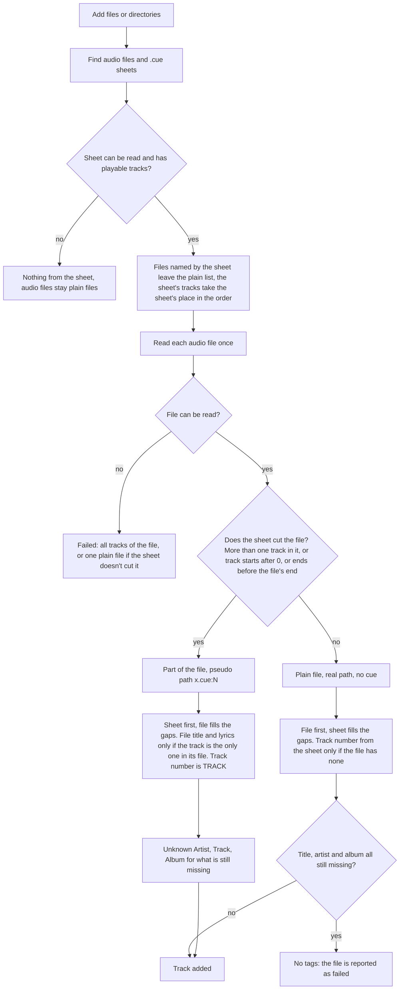

# CUE sheets

How `.cue` files are handled and why. Code: `src/Core/Cue/`, the gatherer (`AudioFileGatherer.gatherInputs`), `ImportSession`,
`PlaybackSource` and the engine's parts. Tests: `tests/Cue*Tests.swift`.

## When the sheet matters

Sheets in the wild are mostly cargo cult: a CUE next to files that were already split into tracks and tagged (CUETools even
writes "dummy" sheets: one `TRACK` per `FILE`, nothing but `INDEX 01 00:00:00`). Only a sheet that **cuts** a file has
something the file doesn't. So every sheet track is decided by `CueTrack.cutsFile`:

- **The sheet cuts the file** (the file has more than one track in the sheet, or the track starts after the beginning of the
  file, e.g. to skip a pregap, or ends before its end): the track is a **part of the file** (the model below), and **the sheet
  comes first**. Whatever the sheet lacks (artist, album, year; title and lyrics only if the track is the only one in its
  file, they are not those of the other tracks) is taken from the file's own tags. The track number is the `TRACK` number.
- **The sheet doesn't cut the file** (the track is the whole file): the sheet is only a playlist of files, and **the file comes
  first**. At import the track is the **plain file** (real path, no `cue`; export, reveal, lyrics and reload all treat it as any
  file) with the file's tags, and the sheet fills in what the file lacks (artist, title, album, year; the track number if the
  file has none). A file with no tags at all gets the sheet's. Reloading such a track reads the file only.

The merge is field by field (`CueTrack.mergedTags`), a blank value counts as missing. The same file is read in both cases (see
"Adding"), so this costs nothing. Reloading a track that is in the playlist as a part (`ReadInput.cuePart`,
`CueTrack.tagResult`) keeps it a part, with the precedence the sheet has now.

### Decision matrix

All of it is `CueTrack.cutsFile` + `CueTrack.importResult`/`tagResult`/`plainResult` + `CueTrack.mergedTags` (pure, tested in
`tests/CueModelTests.swift`; the same decisions through a real import in `tests/CueImportTests.swift`).

**1. What the sheet's track becomes**, per track, after its audio file was read:

| Audio file | Sheet cuts it (`cutsFile`) | Sheet doesn't cut it |
|---|---|---|
| readable | a **part**: pseudo path `x.cue:N`, `cue` slice, album grouped by the sheet's directory; **sheet first** | the **plain file**: its real path, no `cue`, grouped by its own directory; **file first** |
| can't be read (missing, broken) | every track of it fails (a part, the error names the file) | one failed plain file (the file's own failure) |
| readable, no tags at all | a part with the sheet's tags (fallbacks for what the sheet lacks) | the plain file, tagged from the sheet |
| readable, no tags, and the sheet says nothing either | a part, `.partial`, "Unknown ..." (still a track) | the plain file, `.noTags`: **failed**, like any untagged file |

`cutsFile` = more than one track of the sheet in the file, **or** the track starts after 0 (a skipped pregap/silence), **or** it ends
before the file's end. A track that is its whole file doesn't cut it.

**2. Per field**, first value found wins (a blank is missing):

| Field | Sheet cuts: sheet first | Sheet doesn't cut: file first |
|---|---|---|
| title | track `TITLE` -> the file's title, **only if the track is its file's only one** -> "Unknown Track" | file's title -> track `TITLE` -> the file's name |
| artist | track `PERFORMER` -> sheet `PERFORMER` -> file's artist (`artist` > album artist > performer > ...) -> "Unknown Artist" | file's artist -> track `PERFORMER` -> sheet `PERFORMER` -> "Unknown Artist" |
| album | sheet `TITLE` -> file's album -> "Unknown Album" | file's album -> sheet `TITLE` -> "Unknown Album" |
| year | `REM DATE` of the track, else of the sheet -> file's year | file's year -> `REM DATE` |
| track number | the `TRACK` number, always | file's number -> the `TRACK` number |
| lyrics | the file's, **only if the track is its file's only one** (else none) | the file's |
| length | up to the next track's start; the last track of a file: file length - start | the file's length |
| art | the file's embedded picture; a folder image only if the audio is in the sheet's directory | the file's (embedded, or a folder image next to it) |

**3. Typical cases**

| Case | Cuts? | Result |
|---|---|---|
| CUETools dummy sheet, one `TRACK`/`FILE`, tagged files (Pink Floyd) | no | plain files, own tags and track numbers, in the sheet's order |
| One image file + full sheet (EXUMER) | yes | parts with the sheet's titles; artist/album/year from the sheet, gaps from the file |
| One image file + sheet with no titles | yes | parts titled "Unknown Track"; artist/album/year from the file; numbers from `TRACK` |
| Full EAC sheet next to already split, tagged files | no | the files' own tags win, the sheet is ignored in effect |
| Same, files untagged | no | plain files tagged from the sheet |
| One track, `INDEX 01 00:02:33` (gap prepended) | yes | a part that starts at 2.44 s, sheet first, gaps (artist, title: the only track) from the file |
| Sheet names an unsupported file (`.ape`) | - | adds nothing; the file stays the sheet's |
| Only the audio file given | - | a plain file; no sheet is looked for |
| Only the `.cue` given | per file | as above; its files are read |
| Two sheets name one file | per sheet | both add their tracks (duplicates), as before |

**4. Reload Tag(s)**: a part is looked up in its sheet again and stays a part (`cuePart`), with the precedence the sheet has
now; a plain file is read alone, so what the sheet filled in at import (for a file that lacked it) is gone.

## The model (a part of a file)

A sheet that cuts is split into **one playlist track per `TRACK`**. Tracks are independent after that: they can be reordered, removed,
queued and shuffled one by one, like any others, and each has an ID of its own.

- Stored path: the pseudo path `/path/to/album.cue:3` (`CuePath`), never an existing file. The number is the `TRACK`
  number, unless the sheet repeats a number (multi-disc sheets restart at 01 for every `FILE`): then every track of that sheet
  uses its place in the sheet, so paths stay unique. The track number shown is always the `TRACK` number.
- Stored next to it: `"cue": {"file": "/path/album.flac", "start": 215.4, "end": 430.1}` (`end` is missing for the last track
  of a file). Playback doesn't read the sheet again; Reload Tag(s) does, and takes the new tags and places.
- `Track.url` is the audio file (art, waveform, decoder), `Album.directory` is the sheet's directory: tracks of a sheet make
  one album with the album tag of the sheet, whatever directory their audio is in, and look for a folder cover next to the sheet.

## What is read

- Syntax: `FILE`, `TRACK`, `TITLE`, `PERFORMER`, `INDEX`, `REM DATE`. Everything else is ignored. Commands in any case,
  values quoted or not, any line ending. `TITLE`/`PERFORMER` before the first `TRACK` describe the album.
- Encoding: UTF-8 (BOM or not), UTF-16 with a BOM, anything else as Windows-1252.
- **Names are taken as written**: relative to the sheet's directory, or absolute. No other extension, other case or backslash
  is tried. (Where the file system ignores case, `album.FLAC` *is* `album.flac`; that is the file system's answer, not a guess.)
- A file of a format the app can't play (`.ape`, `.wv`, ...) adds nothing, and the file stays the sheet's.
- Start = `INDEX 01` (lowest index if there is none), end = the next track's start in the same `FILE`; the last track of a
  file runs to its end. A pregap (`INDEX 00`) therefore ends up at the end of the previous track, and a hidden track before
  track 1's `INDEX 01` is not played. Data tracks, tracks without an index and tracks that would have no length are skipped.
- Tags: see "When the sheet matters", then the usual rules (`TagReader.finalize`): track `PERFORMER`, else the sheet's, else
  the file's artist, else "Unknown Artist"; no title = "Unknown Track" (a part has no file name to show); no album = "Unknown
  Album"; the year from `REM DATE`. A part with no tags at all is kept.
- Not supported: cue sheets embedded in FLAC (`CUESHEET` block or tag), `PREGAP`/`POSTGAP` silence, `HTOA`.

## Adding

`AudioFileGatherer.gatherInputs` reads every sheet first. Its tracks take the sheet's place in the (natural) order (so a
listing sheet also gives the order of its files), and **the audio files named by any `FILE` line are dropped from the plain
list** wherever they were found, since they come in through the sheet's tracks (`ReadInput.cueTrack`). Dropping or choosing only
the audio file adds it as a plain file (nobody looks for a sheet next to it). Playlist files (`m3u`, `pls`) and the legacy
import never take a `.cue`.

The audio file is read once per file (not once per track), whatever the sheet turns out to do with it (`CueTrack.importResult`):
its tags, the length of the last track, its art (folder cover next to the file, or the embedded picture), and whether it can
be read; a file that can't be read fails all its tracks.

## Playing

The engine plays a `PlaybackSource` (file + start + end). The decoder opens the file, seeks to the start frame and stops at the
end frame; a part that is not in the file (the sheet is wrong, the file is cut) fails like a missing file. Position, length
and seeking are relative to the track. Consecutive tracks of one file are gapless like any two tracks (frame-exact cuts at the
file's rate; a resampled file rounds each track's length on its own, which is at most a frame). The waveform analyses only the
track's frames, and its cache key includes the part.

## Export

No playlist format can name a part of a file, so CUE tracks are left out of m3u/m3u8/pls, and the user is told how many.
